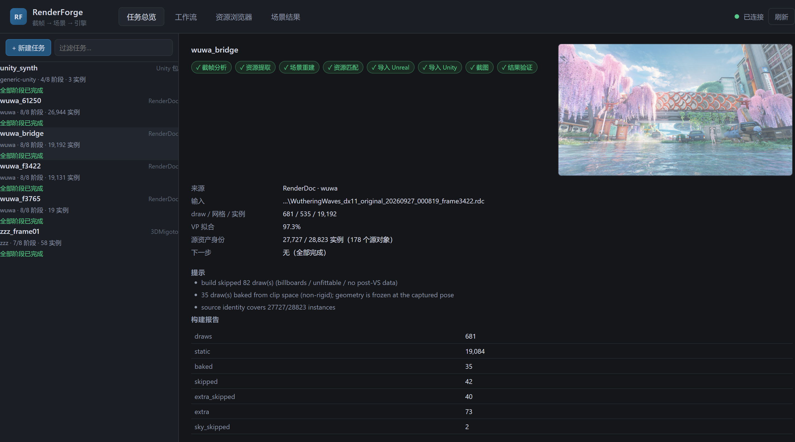
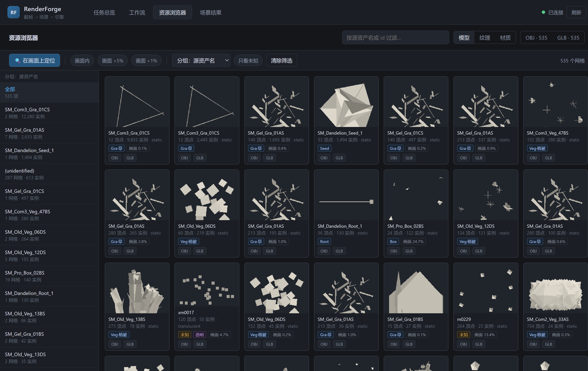
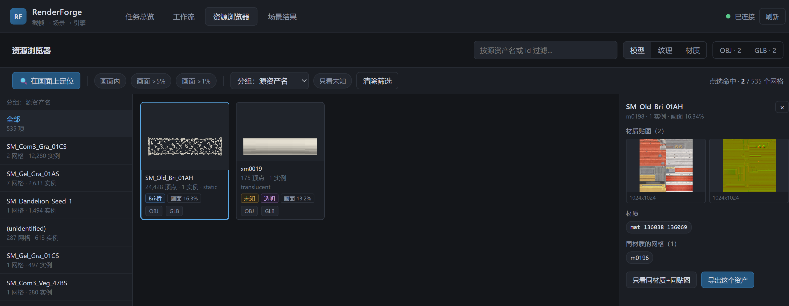

# RenderForge

**截帧 → 可编辑场景：把商业游戏的一帧画面，变成 Unreal Engine 5 或 Unity 里可以继续编辑的资产。**

我从游戏截帧出发，反推出场景里每一个网格的位置、朝向、缩放，解出相机，再还原材质和贴图，最后在引擎里重建出同一个机位的场景，并用数值验证还原得有多接近。整个过程开源、可复现、结果可量化。

> ⚠️ **开发中（v0.1.0）**。下面"当前能力"一节写的每一条都是我在真实数据上跑过并留下证据的；没跑过的一律标"未验证"。请把它当作一个还在成长的研究型工具箱，而不是成品软件。


*左：游戏原帧。右：从该帧重建、在 UE 5.8 中以同一机位渲染的结果。骨架、桥体结构、车辆、人物、水面位置都对应得上；材质与光照仍是预览级，不是游戏的着色效果。*

---

## 目录

- [它解决什么问题](#它解决什么问题)
- [核心思路](#核心思路)
- [当前能力（如实）](#当前能力如实)
- [效果展示](#效果展示)
- [快速开始](#快速开始)
- [使用教程](#使用教程)
- [可视化工作台](#可视化工作台)
- [项目结构](#项目结构)
- [设计取舍](#设计取舍)
- [已知限制](#已知限制)
- [许可证与致谢](#许可证与致谢)

---

## 它解决什么问题

想研究一款游戏的场景构成——它怎么摆模型、用什么材质、贴图怎么分配、光怎么打——最直接的办法是拿到那一帧的 GPU 数据。但截帧工具（RenderDoc、3DMigoto）给你的是一堆原始缓冲：顶点数组、索引缓冲、常量缓冲、贴图资源 ID。这些数据**没有场景语义**：你不知道哪个顶点属于哪栋楼，也不知道那个矩阵把模型放在了世界的哪里。

RenderForge 做的就是补上这层语义：

| 原始截帧给你 | RenderForge 还原出 |
|---|---|
| 几百个 draw call、几千个原始缓冲 | 535 个去重后的网格，每个带源资产名 |
| 每个 draw 的顶点与索引 | 19,192 个实例的世界矩阵（位置/旋转/缩放） |
| 常量缓冲里的一堆 4×4 矩阵 | 相机的位姿、FOV、视投影矩阵 |
| 贴图资源 ID | 底色/法线贴图，以及它们在材质里的角色 |
| 一堆互不相干的数字 | 一个能被 UE/Unity 导入的场景包 |

## 核心思路

```
截帧 (.rdc / 3DMigoto)
      │
      ▼  ① 摄入：导出顶点/索引/post-VS 位置/常量缓冲/贴图
  Extract Package（与来源无关的中立格式）
      │
      ▼  ② 求解：对每个 draw 最小二乘拟合 局部→裁剪空间
  Scene Package（世界矩阵 + 相机 + 材质，声明坐标空间）
      │
      ▼  ③ 发射：UE 5.8 无头 Python / Unity 6 batchmode
  可编辑场景  ──④ 验证──▶ 同机位截图 + SSIM/MAE/覆盖率误差
```

几个关键的技术选择：

**从后置顶点变换反推世界矩阵。** 截帧里最可靠的信息不是常量缓冲（结构因游戏而异），而是"顶点经过顶点着色器之后在裁剪空间的位置"。对每个 draw 做最小二乘拟合，求出局部坐标到裁剪空间的完整变换 `M`；再从常量缓冲的候选 4×4 矩阵里挑出视投影矩阵 `VP`，则世界矩阵 `W = M · VP⁻¹`。这个方法不依赖任何游戏的特定常量布局，因此对绝大多数 UE 游戏通用。

**相机是解出来的，不是猜的。** `VP` 一旦确定，相机位姿、朝向、FOV 都是从矩阵里直接读出来的（位置是齐次矩阵的左零向量）。这意味着重建出来的场景和原帧是**同一个机位**，可以直接做像素级对比。

**无法拟合的非刚体一律"烘焙"。** 蒙皮、风动植被这类每帧顶点都在变的几何，不能用刚性变换描述。这时直接把 post-VS 位置反投影回世界空间，冻结在截获的那一刻——宁可承认它是静态的，也不要编造一个错误的变换。

## 当前能力（如实）

### ✅ 鸣潮（UE4，RenderDoc 截帧 → UE 5.8 与 Unity 6）

这是验证得最充分的路线。

- **世界场景重建**：19,192 个实例、535 个网格，VP 拟合 97.3%
- **源资产身份**：与 CUE4Parse 源网格库做 SHA-256 精确比对，27,727/28,823 个实例（96.2%）带上了游戏自己的资产名
- **透明 pass**：主 pass 之后单独写颜色 RT 的透明物体（73 个实例）被单独导出并合并回场景
- **逐材质混合模式**：从像素着色器反汇编 + D3D11 混合状态读出每个透明材质该用 alpha / 红色通道 / 亮度作遮罩，逐个标注证据等级（proven / judgement）
- **水面**：定位到一个具体的网格，查出"看起来不透明"的真正原因（该网格的顶点缓冲里 UV 解出来恒为 1.0），改用世界坐标投影 UV 绕过

### 🟡 绝区零（Unity，3DMigoto 帧分析 → Unity 与 UE）

- 角色模型（身体/头发/鞋）连同贴图能导入两个引擎
- **但结果还不完整**：头脸缺失（那部分走 GPU 驱动的间接绘制，转储里拿到的是过期参数），身体各部件的位置也还是单位放置、没有对回原姿态。这一路目前只到"数据能读出来"，不构成一张可展示的重建结果
- 世界矩阵与相机的解码适配器已写好，在矩阵层面验证（72/213 个 draw 是刚性变换，投影剪影 IoU 0.9783）
- **未接进 CLI、未端到端渲染**——所以出厂路径仍是单位放置，不要按适配器的数字去预期渲染结果

### 🧪 Unity 资源包 → 场景包（仅合成数据）

- 自己构造的测试包，层级矩阵与 Unity 引擎内的真值误差 1.6e-7
- **没有商业 Unity 游戏样本**，不能声称对真实游戏可用

### ⬜ 未验证

- 原神 / 星铁：本机无安装、无截帧
- 终末地：资源在加密容器里，通用工具打不开，且有反作弊
- D3D12 / Vulkan 截帧：代码路径相同但未实测

### ⚠️ 明确的边界

- **材质是预览级**：底色 + 法线 + 遮罩 + 混合模式。不是游戏的着色器，不追求像素一致。我甚至写了一份[否定结论的文档](docs/MATERIAL_SEMANTICS.md)，记录为什么"线性伴随贴图当 ORM 用"是错的——那会凭空发明材质响应。
- **光照不是游戏的**：重建场景用的是引擎默认的平行光 + SkyAtmosphere + SkyLight。游戏的天空穹顶作为普通网格在场景里，和引擎的大气叠在一起。
- **蒙皮网格冻结在截获姿态**，没有动画。
- **粒子/billboard 跳过**：无法可靠解出变换，宁可留缺口也不伪造。

## 效果展示

**同一个场景包，导入 UE 5.8，同一机位：**


左：游戏原帧。右：从该帧重建、在 UE 5.8 中以同一机位渲染的结果。桥体、车辆、人物、水面都落在对应位置；材质与光照仍是预览级，不是游戏的着色效果。

场景里还缺一些东西，这些是**如实保留的缺口**而不是渲染失误：无法拟合变换的 billboard 与粒子被跳过（桥下的花丛、部分装饰因此缺失），蒙皮几何冻结在截获姿态。另外捕获里的天空穹顶 `m0000` 是作为普通静态网格导入的，和引擎大气叠在一起——这是[已知限制](#已知限制)里记着的一项。

**数值验证**（同机位近似，不是像素测试）：

| 案例 | 来源 | draw / 实例 | UE ssim / mae / 覆盖率误差 | Unity ssim / mae（仅记录） |
|---|---|---|---|---|
| wuwa_61250 | RenderDoc 帧 61250 | 1017 / 26,944 | 0.393 / 0.242 / 0.077 | 0.332 / 0.275 |
| wuwa_bridge | RenderDoc 帧 3422 | 681 / 19,192 | 0.339 / 0.300 / 0.149 | 0.333 / 0.272 |
| wuwa_f3765 | RenderDoc 帧 3765 | 19 / 19 | 0.532 / 0.331 / 0.032 | 0.732 / 0.207 |
| zzz_frame01 | 3DMigoto | 213 / 58 | 0.212 / 0.328 / 0.131 | 有截图，未打分 |

SSIM 只能用来比较**同一案例改前改后**，不能跨案例比优劣——不同场景的构图、遮挡、背景占比差别太大。

Unity 列只是记录：Unity 侧目前有一个未修的问题——捕获的天空穹顶在 Unity 里被渲染到相机前方，整帧被一个巨大的球面挡住，所以那几列数字不代表重建质量。UE 侧的截图正常。

## 快速开始

### 环境要求

- Windows 10/11（重建路径依赖 RenderDoc 与 UE/Unity 的 Windows 可执行文件）
- Python 3.12（推荐用 [uv](https://docs.astral.sh/uv/)）
- [RenderDoc](https://renderdoc.org/) 1.45+（仅 RenderDoc 路线需要）
- Unreal Engine 5.8 和/或 Unity 6000.0（仅发射到引擎时需要）

### 安装

```bash
git clone https://github.com/<your-name>/RenderForge.git
cd RenderForge
uv venv .venv
uv pip install -e .
```

### 30 秒自检（不需要 GPU、不需要引擎）

```bash
.venv\Scripts\python.exe -m renderforge selftest
```

会跑 6 项离线回归：坐标空间往返、Unity 摄入、场景包完整性、指标自洽、案例扫描、工具箱数据交叉引用。约 4 秒。

```bash
.venv\Scripts\python.exe -m renderforge doctor        # 本机装了哪些工具
.venv\Scripts\python.exe -m renderforge plan --game wuwa --target unreal   # 这个游戏该用哪些工具、哪里有缺口
```

## 使用教程

### 路线一：RenderDoc 截帧 → UE 场景（最完整）

**1. 抓一帧。** 用 RenderDoc 附加到游戏进程，按 F12 捕获一帧。截帧文件通常 1–2 GB，项目**只读不改，也不复制**。

**2. 建立任务并分析这一帧。**

```bash
# 建任务目录（也可以在工作台页面里点「+ 新建任务」）
.venv\Scripts\python.exe -m renderforge survey wuwa_bridge --rdc "D:\captures\...frame3422.rdc"
```

`survey` 会列出所有 draw call，按渲染目标（RT）分组，帮你找出"主场景在哪个 pass"。输出里会给出候选 pass 的 RT 数量、格式、尺寸和 draw 范围。

**3. 导出资源。**

```bash
.venv\Scripts\python.exe -m renderforge export wuwa_bridge
```

导出顶点、索引、post-VS 位置、常量缓冲、贴图和顶点着色器用的 SRV。产物在 `workspace/wuwa_bridge/export/`。

**4. 求解场景。**

```bash
.venv\Scripts\python.exe -m renderforge build wuwa_bridge
```

对每个 draw 拟合变换、挑选 VP、解出相机，写出 `build/scene.json`。输出会告诉你 VP 拟合比例、有多少 draw 被跳过、多少被烘焙。

**5. 导入引擎。**

```bash
.venv\Scripts\python.exe -m renderforge ue-import wuwa_bridge
.venv\Scripts\python.exe -m renderforge shot wuwa_bridge        # 无头游戏模式截图
.venv\Scripts\python.exe -m renderforge metrics wuwa_bridge     # 与游戏原帧比数值
```

**6. 或者一条命令跑完。**

```bash
.venv\Scripts\python.exe -m renderforge run wuwa_bridge
```

已有的产物会自动跳过；失败的步骤会停下并打印从哪一步续跑。看看现在跑到哪了：

```bash
.venv\Scripts\python.exe -m renderforge status
```

```
case         source     game      stages                                          draws    inst  next
wuwa_bridge  rdc        wuwa      +survey +export +build +identify +emit-ue +emit-unity +shot +metrics    681   19192  done
zzz_frame01  3dmigoto   zzz       +survey +export +build -identify +emit-ue +emit-unity +shot +metrics    213      58  done
```

### 路线二：3DMigoto 帧分析 → 角色模型

适用于 RenderDoc 无法注入的游戏（很多二次元游戏有反作弊）。

```bash
.venv\Scripts\python.exe -m renderforge ingest-3dmigoto zzz_frame01 --frame-dir <FrameAnalysis-...> --game zzz
.venv\Scripts\python.exe -m renderforge build-model zzz_frame01 --game zzz
.venv\Scripts\python.exe -m renderforge unity-import zzz_frame01
```

3DMigoto 的转储里**没有 post-VS 数据**，所以无法用上面的变换求解，只能按模型空间放置，再乘上游戏档案里记录的基准朝向。

### 路线三：只有 Unity 资源包（不需要截帧）

```bash
.venv\Scripts\python.exe -m renderforge ingest-unity my_case --bundle <file.bundle>
.venv\Scripts\python.exe -m renderforge ue-import my_case
```

### 读懂材质的贴图语义

想知道某个贴图槽位到底是底色、遮罩还是法线，**从着色器读，不要从贴图长得像什么推断**：

```bash
# 反汇编指定 draw 的像素着色器（--vs 切到顶点着色器）
.venv\Scripts\python.exe -m renderforge shaders wuwa_bridge --eids 2037,2263
```

输出在 `workspace/<case>/shaders/`，包含反汇编文本。我用它确认过鸣潮里一张看起来像 ORM 的贴图其实是色调伴随贴图。

### 按 agent 的方式用（MCP）

项目自带一个 MCP 服务器，把同样的能力暴露给 Claude 等 agent：

```bash
cp .mcp.example.json .mcp.json    # 然后把里面的路径改成你的
```

工具：`doctor`、`plan`、`games`、`status`、`run`、`step`、`metrics`、`job_start`、`job_status`、`job_log`、`jobs`。全部返回 JSON 文本，失败以 `isError` 返回。耗时步骤用 `job_start` 起后台作业，日志落在 `workspace/_jobs/<id>.log`。

## 可视化工作台

除了命令行，还有一个本地 Web 界面（标准库 HTTP 服务器 + 原生 JS，无框架、无构建步骤）：

```bash
.venv\Scripts\python.exe -m renderforge web     # → http://127.0.0.1:8770/
```

**任务总览** —— 每个案例的来源、阶段完成度、draw/网格/实例数、VP 拟合、身份覆盖率，右侧挂该案例的原帧。支持新建任务（填本机 `.rdc` 路径）和重命名。



**资源浏览器** —— 按源资产名/类别码/关卡目录/渲染方式/屏幕占比分组；每张卡片显示顶点数、实例数、画面占比，悬停用 WebGL 实时旋转，双击打开 3D 查看器。



**在画面上定位** —— 点原帧上的任意位置，射线穿过相机与场景几何求交，按深度列出命中的资产；选中后显示它的材质、贴图（可下载原图），以及共用同一材质/贴图的网格。这是"我看到画面里那个东西，想立刻找到它"的完整路径。



**导出** —— 单个网格可导出 OBJ / GLB，贴图导出原始 PNG，筛选结果可整批打成 zip（内含 `scene.json`、`INSTANCES.csv` 记录每个实例的世界矩阵、`CAMERA.json`、`REPORT.md`）。大案例在子进程里跑，不阻塞页面。

## 项目结构

```
renderforge/                  Python 包
  cli.py                      python -m renderforge 的入口
  rd_scripts/                 在 RenderDoc 内部运行的脚本（Python 3.6，仅标准库）
    rf_extract.py             导出顶点/索引/贴图/常量缓冲；shaders 模式反汇编着色器
  ue_scripts/                 在 UE 内部运行的脚本（Python 3.11）
  ingest_3dmigoto.py          3DMigoto Frame Analysis 摄入
  ingest_unity.py             Unity 资源包摄入（UnityPy）
  build.py                    变换求解 + 相机求解 → scene.json
  solve.py                    最小二乘拟合、矩阵分解等数值方法
  space.py                    UE ↔ Unity 坐标空间转换
  identify.py                 与源资产库做指纹比对
  metrics.py                  SSIM / MAE / 覆盖率误差 / IoU
  caseinfo.py / pipeline.py   案例状态与可续跑步骤图
  mcp_server.py               MCP 服务器（stdio）
  adapters/                   游戏专用适配器（一个游戏一个模块，互不引用）
  web/                        本地可视化工作台
toolbox/                      工具注册表、游戏档案、工作流（数据驱动）
docs/                         架构、工具地图、里程碑截图
ue_project/  unity_project/   两个引擎的目标工程
workspace/<case>/             每个案例的产物（git 忽略）
```

**两个中立的数据契约**是项目可扩展的关键：

1. **Extract Package** —— 摄入层的输出，与来源无关。RenderDoc 和 3DMigoto 都写这个形状。
2. **Scene Package** —— 对账层的输出，发射器的输入。声明坐标空间（`ue` / `unity`），带网格实例矩阵、材质、贴图、相机。

加一个新来源或新目标引擎，只需要写它到这两个格式之一的适配器，不用碰其他环节。

## 设计取舍

**能不猜就不猜。** 无法可靠求解的几何（billboard、粒子、GPU 间接绘制的部分）宁可跳过并记录，也不生成一个"看起来对"的假结果。`scene.json` 里每个被跳过的 draw 都有据可查。

**证据分级。** 材质混合模式分成 `proven`（从着色器反汇编 + 混合状态读出）和 `judgement`（推断）。同一个案例里 12 个透明材质，6 个 proven、5 个 judgement、1 个 skipped——这个区分写在导入结果里，不会被混为一谈。

**指标是记录，不是判据。** SSIM 只用来回答"这次改动比上次好了吗"，不设通过阈值，也不跨案例比较。相机是近似求解的，光照和游戏不同，所以它测量的从来不是像素一致性。

**不装的东西不写成可用。** 工具箱里每个工具都标状态：`OK`（本机对真实数据跑过）、`OK*`（合成数据）、`OK(prior)`（有历史证据但本次未跑）、`cand`（候选）、`ref`（仅参考）。没标 OK 的不要当作可用能力。

## 已知限制

- 只有**鸣潮**（D3D11 / UE4）有完整真实数据链路；Unity 源路线只在自建测试包上验证过
- **Unity 侧当前有一个未修问题**：捕获的天空穹顶网格在 Unity 里被渲染到相机前方，整帧被一个巨大的球面挡住。UE 侧正常。Unity 的 SSIM 数字因此只做记录，不代表质量
- 材质是预览级，光照是引擎默认，天空不是游戏的
- 蒙皮/动画未还原，非刚体几何冻结在截获姿态
- 只有整帧指标，还不能回答"具体哪个物体不对"
- 逐材质常量块（真正的 PBR 路径）尚未解码
- ZZZ 适配器已实现但未接入 CLI
- 不支持 D3D12 / Vulkan 的实测验证

完整清单与推进顺序见 [ROADMAP.md](ROADMAP.md)。

## 许可证与致谢

本项目采用 [MIT 许可证](LICENSE)。

使用到的第三方工具各有自己的许可证：RenderDoc（MIT）、3DMigoto、UnityPy（MIT）、CUE4Parse（Apache-2.0）、AssetRipper（GPL-3.0，**仅作为独立进程调用，不链接、不复制代码**）、three.js（MIT，已内置在 `renderforge/web/static/vendor/`）。

**本项目不包含任何游戏的资源文件、截帧数据或密钥**，也不提供获取它们的工具。截帧与资源解包需要使用你自己的工具和合法的游戏副本。请遵守你所研究游戏的服务条款与当地法律。

---

*RenderForge 还在早期。如果你在研究类似的渲染逆向问题，欢迎开 issue 讨论。*
