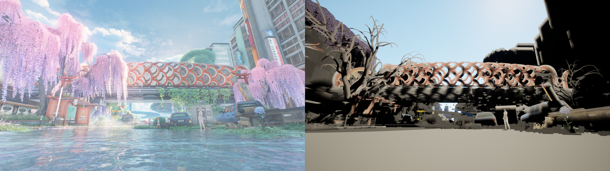

# RenderForge 开发路线图

状态：✅ 已在真实数据上跑通验证　🟡 初步可用/部分验证　⬜ 未开始

```
[M0 工作区 ] ██████████ 100%   环境调查、仓库、参考项目
[M1 提取   ] █████████░  90%   RenderDoc 截帧 → 网格/UV/贴图/常量缓冲（无界面）
[M2 重建   ] ████████░░  80%   世界矩阵 + 相机自动求解（静态/实例/烘焙）
[M3 导入UE ] ███████░░░  70%   无头导入 → 可编辑关卡，机位与原画面一致
[M4 对话化 ] ███░░░░░░░  30%   命令行 + CLAUDE.md；renderdoc-mcp 已接入；UE MCP 未接
[M5 资源匹配] ░░░░░░░░░░   0%   用游戏原始资源(FModel/UnityPy…)替换 GPU 提取物
[M6 材质   ] ██░░░░░░░░  20%   贴图分类(底色/法线)+遮罩；shader 语义未还原
```

## 里程碑图

（《鸣潮》桥梁场景：2GB 截帧 → UE 5.8 关卡，GBuffer pass 681 个 draw → 19k 实例。缺：紫藤/水面（在其他 pass）、光照与天空。）

## M0 工作区与调研 ✅
- ✅ 本机：RenderDoc 1.45、UE 5.8.2、uv/Python 3.12、git
- ✅ renderdoc-mcp v0.3.0（MIT）可用于对话式分析；**`qrenderdoc.exe --python` 可无界面跑完整 RenderDoc Python API**（这是批量提取的核心）
- ✅ 参考项目在 `refs/`（RDC2UE 无许可证，只借鉴思路）

## M1 提取 ✅/🟡
- ✅ `survey`：列 draw、按渲染目标分组自动找场景 pass（1.9GB 截帧 77 秒）
- ✅ `export`：顶点属性、索引、post-VS 位置(含实例)、cbuffer、PS 贴图 PNG、**VS buffer SRV（manual vertex fetch 的 UV/切线）**、PS 是否 discard
- ✅ 验证数据：《鸣潮》D3D11（角色 UI 帧、世界场景帧）
- ⬜ D3D12 / Vulkan / GL 截帧
- ⬜ 立方体/数组贴图、HDR 贴图(EXR)
- ⬜ 非三角形列表拓扑（strip 目前跳过）

## M2 重建 ✅/🟡
- ✅ 通用变换求解：最小二乘 local→clip；从 cbuffer 自动识别 VP（97% 静态 draw 吻合）
- ✅ 实例化 draw 拆分（一个 draw 19k 实例级别）、平面卡片矩阵修复、TRS 分解
- ✅ 相机位置/朝向/FOV 自动还原（UE 内实测与原机位一致）
- 🟡 蒙皮/风动 draw 用 post-VS 反投影“烘焙”（姿态冻结在该帧；过滤相机后/超远顶点）
- ⬜ 世界坐标系绝对对齐（目前以 VP 候选的平移族为准，场景以相机附近为原点）
- ⬜ 多 pass（半透明/前向 pass、水面、天空）合并

## M3 导入 UE 5.8 🟡
- ✅ 无头 `UnrealEditor-Cmd`：贴图导入、StaticMesh、材质实例、Blueprint-ISM 实例化、关卡保存（523 网格 / 19k 实例 / 约 45 秒）
- ✅ 无头游戏模式截图（PlayerStart + fov），并生成 RenderDoc 原画面对比图
- 🟡 材质：底色 + 法线 + 遮罩(discard)；无 PBR 参数、无天空/光照还原
- ⬜ 法线直接写入（UE Python 无接口，目前靠 UE 重算）
- ⬜ 大场景分区/合并，LOD

## M4 对话化 🟡
- ✅ `python -m renderforge survey|export|build|ue-import|shot|compare|run`
- ✅ `.mcp.json`（renderdoc-mcp）、`CLAUDE.md`（流程与已验证事实）
- ⬜ UE 官方 MCP / funplay-unreal-mcp 接入，边聊边改 UE 场景
- ⬜ 项目 skill（把"选 pass / 判定材质"等判断写成可复用步骤）

## M5 游戏资源匹配 ⬜
- ⬜ 游戏 profile 机制（每游戏一个 JSON，互不影响）
- ⬜ UE 游戏：FModel/CUE4Parse 导出 → 以网格/贴图哈希匹配替换 GPU 提取物
- ⬜ Unity 游戏：UnityPy / AssetRipper；坐标系/单位转换

## M6 材质 🟡
- ✅ 按格式分类底色(SRGB)/法线(BC5)，discard → 遮罩
- ⬜ ORM / 自发光 / 次表面通道含义（需读 shader/cbuffer）
- ⬜ 水、天空、角色卡通渲染

> 说明：每个条目都标注“已验证 / 初步实现”。没有跑过的功能不会标 ✅。
